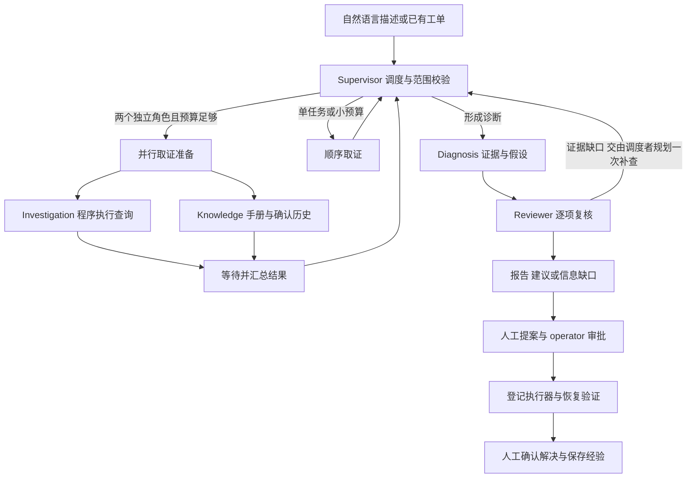

# IT Incident Agent

模型通过 LangChain `ChatOpenAI` 调用 OpenAI 兼容的 Chat Completions 接口。配置 `MODEL`、`MODEL_BASE_URL`、`MODEL_API_KEY`（未设置则沿用 `DASHSCOPE_API_KEY`）；同服务内切换支持工具调用和 JSON 输出的模型通常只改 `MODEL`。跨服务需调整地址和密钥，厂商参数由 `MODEL_EXTRA_BODY` 的 JSON 对象提供：当前通义为 `{"enable_thinking":false}`，不支持此参数的服务使用 `{}`。单次超时 30 秒，SDK 自动重试为 0，程序继续校验输出结构与证据。服务需重启以加载配置。详见[兼容接口迁移记录](examples/showcase/openai-compatible.md)。

默认采用[计划驱动取证与直接复核](examples/showcase/planned-investigation.md)：Supervisor 规划具体查询，Investigation 程序模块校验并执行，不调用独立取证模型。原始证据交给 Diagnosis/Reviewer 判断，查询完成不等于原因确认。旧 `agent` 模式与观测盲审仍可显式用于对照；免费脚本演示保留原控制流程。

最新[取证执行和调度职责](examples/showcase/collection-boundaries.md)：Knowledge 也按计划执行检索；Supervisor 收窄为规划职责，证据支持程度交给诊断与复核。补查任务数量在派发前校验，三个核心模型角色各有全运行一次纠正额度，均计入原总预算。

[复核关键缺口与核查结果说明](examples/showcase/review-materiality.md)：按问题实际影响区分未知项，默认核查建议采用程序生成的中性预期结果，原文保留审计。真实验证保留失败与误拦；有条件变更复核仍偏保守。

实现已保存为冻结点；[三个新案例的审阅](examples/showcase/frozen-review.md)发现两例在诊断纠正时受到输入长度门禁限制，另一例仍有机制与触发混用、错误排除候选的问题。保留冻结版本与全部失败记录，尚不能宣称整体效果稳定。

后续[输入纠正与程序取证交接修复](examples/showcase/context-recovery.md)分别提交输入重建和失败观测展示，保留全部证据、原契约与预算。真实回放未再触发输入长度门禁，但引用格式及 Reviewer 契约失败仍保留在[验证记录](examples/showcase/context-recovery-runs.json)中。

[Reviewer 契约与收尾](examples/showcase/review-handoff.md)：程序按问题用途填充缺口类别；机制和有效下一步已复核、关键证据完整时，纯触发未知作为人工待核实限制保留。关键未知仍阻塞，原补查请求和未确认结论保留在运行记录。

[Reviewer 分阶段纠正额度](examples/showcase/reviewer-stage-budget.md)亦可切换试验：split 模式盲审和最终复核各最多纠正一次，仍计入原总预算；默认保留共享一次。

面向内部服务故障的诊断与处置辅助系统，主要展示 AI Agent 编排与 Harness 工程：自然语言生成工单、受限计划取证、证据诊断、独立复核、一次定向补查，以及人工审批后的受控修复。

## 快速体验

使用 Python 3.12，在项目独立虚拟环境中安装 `requirements.txt`。免费演示不需要模型 Key、数据库或 Docker：

```powershell
.\.venv\Scripts\python.exe scripts/demo_interview.py
.\.venv\Scripts\python.exe scripts/demo_parallel_collection.py
```

第一条命令生成历史经验核查、冲突证据、复核补查三个演示及本地展示页；第二条比较相同脚本响应的串行与并行取证。输出保存在被 Git 忽略的 `output/` 批次目录。

演示使用真实 LangGraph 和工具执行器，但模型响应预设、观测合成。它验证控制流程，不能作为自主推理准确率。并行演示使用人工延迟，不能外推真实模型提速比例。完整免费检查与模拟审批闭环可运行：

```powershell
.\.venv\Scripts\python.exe scripts/showcase_incident.py
```

实际后端、数据库、身份及前端启动步骤见 [Windows 本地启动](README_LOCAL.md)。真实模型诊断需要显式授权和预算，修复需要独立审批及执行确认。

## 当前能力与执行流程



- 默认 Supervisor、Diagnosis、Reviewer 使用同一基础模型的不同提示词和局部消息历史；Investigation 与可选 Knowledge 为执行已校验查询的程序模块。LangGraph 编排阶段，两类取证同轮独立任务可并行，诊断、复核及定向补查顺序执行。
- 六个只读工具：指标、日志、变更、负责人、手册检索、已确认历史工单检索。执行前检查身份、角色、服务、环境、版本与时间范围。
- 取证按症状、机制与合理替代解释的问题覆盖决定收尾，聚焦查询不代替完整性；未解决问题在限次或预算耗尽时明确保留。Reviewer 提交证据缺口，Supervisor 可替换查询提示并规划具体补查，执行器只执行通过权限、去重和预算检查的调度计划。
- RunContext 原子计数并约束模型、工具及时间预算；分支持有独立台账，汇总证据并保留失败缺口。严格输出契约、服务端来源引用、查询去重、任务检查与有界结构纠正构成 Harness。
- 总上限由环境与已授权请求决定，当前配置示例为32次模型、48次工具、300秒。常规最多4次调度、6个任务、1轮补查；仅在明确区分价值、新查询及完整收尾预算通过门禁后，最多[追加一次补查](examples/showcase/additional-rework.md)，临时开放第5次调度/第7个任务位置。默认 Supervisor、Diagnosis、Reviewer 全运行各最多纠正1次，均消耗原模型总预算；旧 Agent 模式保留共享取证/诊断1次及 Reviewer 1次，单 Agent 仍最多1次。
- 默认 Reviewer 直接核验原始证据、台账和草稿，输入不含已有问题状态、旧复核结论或取证模型的候选判断。观测盲审保留为可选对照，两种路径都保留引用校验和阻塞审计；症状、机制的阻塞属性由程序固定，模型只能评估证据是否支持。历史迭代见[改进记录](examples/showcase/agent-improvement.md)。
- 阻塞复核须说明缺失观测、影响目标和判断变化；报告分开记录查询执行、机制支持与停止原因，合法补查交给调度者规划。实施及真实失败轨迹见[诊断审计记录](examples/showcase/diagnostic-audit.md)。
- 当前在 v6 恢复点上[精简最终 Reviewer](examples/showcase/focused-review.md)，并校验[缺口归属、预留补查预算](examples/showcase/scope-rework-budget.md)：判断结论、下一步和证据缺口，补查参数由 Supervisor 规划。Qwen 调用、严格 JSON、证据引用、阻塞审计和有界补查保留。恢复点见[版本回退记录](examples/showcase/rollback-v6.md)；逐项断言和决策分支实验已撤回，见[历史记录](examples/showcase/claim-decision-review.md)。
- 工单与运行按服务端身份隔离，PostgreSQL 保存结果、事件与修复阶段，SSE 支持续读。JSON 日志位于 `logs/incident.log`，指标位于 `/metrics`。
- 登记服务可接入 Prometheus/Loki 与私有确认历史；未登记渠道明确返回缺口。提供知识库 Worker、API、PostgreSQL、Redis 的配置示例，数据库与缓存示例目前只有运维日志。
- 修复独立于诊断：Agent 候选或人工提案 → 绑定证据、工单版本及配置 → operator 审批 → 单次执行 → 有界恢复验证。当前默认执行器只支持精确登记 Docker 容器的重启，拒绝任意脚本、Shell、扩缩容与回滚。

`completed` 表示诊断流程完成，`passed` 表示本次复核通过；二者都不表示工单已解决、唯一根因已确认或修复已批准。修复验证通过也不会自动关闭工单。

## 源码目录

| 路径 | 职责 |
| --- | --- |
| `app/api/`、`app/app_main.py` | FastAPI 入口、认证、工单、运行回放及修复接口 |
| `app/agents/` | 模型契约与提示词、Knowledge / 旧取证工具循环、单 Agent 对照路径 |
| `app/workflow/` | LangGraph、调度、问题台账、补查、复核与收尾 |
| `app/runtime/` | 全局和分支预算、调用计数与追踪 |
| `app/tools/`、`app/providers/` | 受限工具执行、登记来源、查询及历史适配 |
| `app/evidence/` | 来源、引用、诊断完整性与报告渲染 |
| `app/repairs/` | 提案、审批、固定执行器及恢复验证 |
| `app/storage/`、`app/observability/` | PostgreSQL 与迁移、JSON 日志和指标 |
| `front/agent_front/` | Vue / TypeScript 调试台、报告、审批及执行进度 |
| `scripts/` | 本地演示、登记预检、只读试连与显式评测入口 |
| `tests/`、`evals/`、`fixtures/` | 免费回归、冻结对照数据和受控评测 |
| `examples/` | 服务登记示例、面试材料和公开验证摘要 |
| `archive/research/` | 只供追溯的原研究成果，不参与当前运行和安装 |

后端入口为 `main.py` 与 `local_run.py`。结果读取使用 `/api/v1/runs/{run_id}`；旧研究运行 URL 仅保留只读兼容。Python 包构建与 `requirements.txt` 使用相同的锁定依赖，不再安装研究、Milvus 或 Redis 检查点依赖。

## 验证与面试材料

- [五分钟讲解与追问](examples/showcase/interview-guide.md)、[编排与 Harness 设计](examples/showcase/design.md)、[Harness 证据](examples/showcase/harness.md)。
- [并行取证与免费验证](examples/showcase/parallel-collection.md)、[完整公开展示入口](examples/showcase/README.md)。
- [调查覆盖与复核缺口调度](examples/showcase/coverage-rework-planning.md)：当前补查职责、覆盖退出、预算及免费验证。
- [定向真实模型对照](examples/showcase/curated-live-guide.md)：保留失败、partial、版本及报告哈希。当前结果未证明多 Agent 整体诊断质量领先。
- [历史开发说明](examples/showcase/development-history.md)：集中保留此前实施过程、真实对照和验收限制，不用旧阶段结果替代当前验证。
- [本次清理与收尾](examples/showcase/cleanup-closeout.md)：删除项、历史归档、打包与免费验证结果。

GitHub Actions 检查免费后端控制、前端类型与构建、隔离 PostgreSQL 集成。各次验证成绩绑定对应源码与记录；不把脚本结果当作真实模型成绩，不宣称生产规模或 SLA。当前没有 checkpoint 恢复、跨进程调度、服务管理页面或索引任务查询工具。

真实 `.env`、身份令牌、`services.local.json`、数据库与原始运行数据不提交。`docs/` 继续本地维护并由 `.gitignore` 排除。已提交的研究覆盖与审计源码和历史验收证据保留，未删除或恢复旧草稿。
