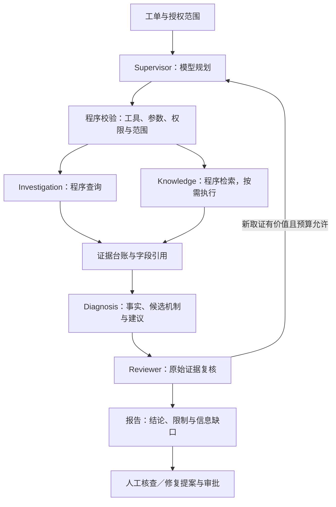

# IT Incident Agent

基于 **LangGraph 的 AI Agent 故障调查与诊断辅助系统**。从自然语言工单出发，规划少量有价值的查询，执行受限取证，形成可追溯的候选解释，再复核结论与信息缺口；证据不足时交给人工核查，修复通过独立审批流程执行。

项目面向运维调查中**观测来源分散、查询重复、结论缺少依据**的问题。当前 `main` 为收尾版，默认采用 **3 个模型角色 + 2 类程序取证模块**，重点展示规划、工具使用、证据交接、有限反馈闭环与执行边界。

[系统架构](examples/showcase/system-architecture.md) · [案例验证与离线复现](examples/showcase/validation-closeout.md) · [本地启动](README_LOCAL.md) · [全部验证材料](examples/showcase/README.md)

技术栈：Python 3.12 · LangGraph · LangChain · Pydantic · FastAPI · PostgreSQL / pgvector · Vue / TypeScript。

## AI Agent 架构与执行流程



| 角色或模块 | 职责 | 执行方式 |
| --- | --- | --- |
| Supervisor | 选择能改变判断的检查，输出登记工具、具体参数和预期信息价值 | 模型规划，程序验证后执行 |
| Investigation | 查询指标、日志、变更与负责人，记录真实查询结果 | 程序取证，无额外取证模型调用 |
| Knowledge | 按需检索排障手册与已确认历史工单 | 程序检索；历史相似性仅作线索 |
| Diagnosis | 基于来源形成事实、候选机制、未知项和下一步 | 模型诊断，无工具权限 |
| Reviewer | 核对事实、整个因果陈述、建议条件和关键证据需求 | 模型复核，无工具权限 |

三个模型角色使用同一基础模型配置，按职责组织请求；Reviewer直接读取原始证据与程序台账，独立阶段复核仍可能共享模型偏差。独立取证任务可并行，诊断与复核顺序执行。

常规最多一轮补查，追加一轮须满足新查询、区分价值与完整收尾预算门禁。三个模型角色各有全运行一次结构纠正额度，计入原总预算。预算或证据不足时允许以 `partial` 结束。

## 核心技术亮点

| 能力 | 实现与工程价值 | 源码入口 |
| --- | --- | --- |
| 结构化规划与契约 | Pydantic契约约束计划、工具参数与角色输出；格式失败提供字段级反馈并有限纠正 | [Protocol](app/agents/protocol.py)、[Planning](app/workflow/planning.py) |
| 受控工具执行 | 六类只读能力覆盖指标、日志、变更、负责人、手册与历史；程序校验身份、角色及工单范围 | [ToolExecutor](app/tools/executor.py)、[Providers](app/providers/) |
| 证据可追溯 | 服务端生成EV证据编号与REF字段引用；事实绑定实质来源，Reviewer核对原始观测和查询状态 | [Evidence](app/evidence/)、[Review](app/workflow/review.py) |
| 预算与查询台账 | RunContext统一计数、原子领取预算并预留收尾；规范化查询用于去重，避免同目标不同查询被误拦 | [RunContext](app/runtime/context.py)、[Coordinator](app/workflow/coordinator.py) |
| 知识检索与适用性 | 排障手册切分、Embedding与pgvector检索，支持上传 `.md` / `.txt`；历史背景与当前观测分开使用 | [Knowledge](app/knowledge/)、[RAG说明](examples/runbook-rag.md) |
| 人工审批与恢复验证 | 诊断建议与服务变更分开；登记动作经权限与审批后执行，再进行有界恢复验证 | [Repairs](app/repairs/)、[维护执行器](examples/maintenance-executors.md) |

查询台账区分成功、查空、失败和截断。引用合法只证明来源身份有效，不能自动证明因果；业务现象仍需要业务记录支持。PostgreSQL保存运行结果与事件，SSE支持事件续读，JSON日志与指标用于追踪；当前没有checkpoint恢复或跨进程调度。

## 两个验证案例

以下为已保存的**真实模型请求 + 合成只读工具数据**，来自不同验证批次，用于核查执行机制与限制，不汇总为准确率。完整输入、响应、复核、失败及预算事件均留档。

### 案例一：只读挂载导致索引写入受阻

- **观测**：日志记录 `EROFS`，进程命名空间内挂载标志为 `ro`；空间与inode数据未显示容量耗尽。
- **执行链路**：原始日志 → 字段来源 → 近端写入机制 → Reviewer评估 → 人工核实触发原因。
- **运行结果**：4次模型请求、2次工具执行，`completed / passed`。
- **解释边界**：为什么变成只读仍未知；原报告对竞争解释排除偏强，部署完成时间不能证明开始／生效时间。流程完成不等于服务恢复。

[案例记录：closeout_002](examples/showcase/standard-flow-repairs.md#首批三个自主真实检查)

### 案例二：业务重复投诉，日志不可用

- **调查条件**：用户报告订单重复处理，日志渠道不可用，已有技术指标不足以建立业务因果。
- **执行链路**：查询失败台账 → 复核缺口 → 保留未知 → 人工待办与交接。
- **运行结果**：6次模型请求、3次工具执行，`partial / needs_information`，停止原因 `NEEDS_INFORMATION`。
- **已知缺陷**：原报告仍用技术指标支持业务现象，部分候选的因果方向也不充分。交接结果有效与诊断准确分开评估；需人工关联订单、请求、幂等键、消费尝试和成功结果。

[案例记录：closeout_003](examples/showcase/validation-closeout.md#两个固定验证案例) · [离线案例复现](examples/showcase/validation-closeout.md)

`completed` 表示诊断流程完成，`passed` 表示内部复核通过。两者均不表示唯一根因已确认、工单已解决或修复已批准；修复验证通过也不会自动关闭工单。

## 快速体验

免费标准流程排练不需要模型Key、数据库或Docker。使用Python 3.12，在仓库根目录安装依赖并运行：

```powershell
python -m venv .venv
.\.venv\Scripts\python.exe -m pip install -r requirements.txt
.\.venv\Scripts\python.exe scripts/demo_standard_flow.py
```

该演示使用真实LangGraph与工具执行器，但模型决策由脚本提供、观测合成。收尾时排练结果为4次脚本模型步骤、2次工具执行、0次取证模型调用、0次付费请求；输出写入新的 `output/` UUID目录。它验证控制流程，不作为自主诊断质量成绩。

两个真实案例的报告可按[离线配方](examples/showcase/validation-closeout.md#离线复现报告展示)生成Markdown与JSON，无需再次付费调用。实际后端、数据库、身份及前端启动见[Windows本地启动](README_LOCAL.md)，模型接口配置见[兼容接口说明](examples/showcase/openai-compatible.md)。

## 验证结果与设计取舍

| 验证 | 已确认结果 | 适用边界 |
| --- | --- | --- |
| 收尾运行时代码回归 | 701项：681通过、20项数据库检查跳过 | 工程回归，不能替代真实服务、数据库或诊断质量验收 |
| 最小修复真实检查 | 两批4次运行、24次请求；保留复核失败与缺信息结果 | 两批源码版本不同，不宣称终版三个案例全部通过 |
| 最后提示对照 | 两个已见案例，原提示／候选各一次，共24次请求；候选未保留 | 局部收益伴随命题反转与无效渠道重试建议，小样本不证明因果或稳定收益 |

各项成绩绑定对应源码和记录，两个24请求批次分别统计；没有证明多角色整体质量领先，也不宣称生产规模、SLA或根因准确率。

曾尝试更复杂的修稿范围约束、补查分流与仲裁，规则之间产生冲突，真实验证未证明稳定收益。收尾版恢复基础架构，只保留参数定位、输入额度配置、查询标识及阻塞反馈等通用修复。最后的提示候选没有清晰整体收益，恢复原提示后停止优化。

实验分支 [codex/review-driven-orchestration](https://github.com/Heresy0/IT_Incident_Agent/tree/codex/review-driven-orchestration)及全部失败档案保留。旧实验能力与成绩按当时版本解释，不作为当前默认成绩。

## 继续阅读

| 入口 | 内容 |
| --- | --- |
| [系统架构](examples/showcase/system-architecture.md) | 模块职责、状态与预算归属 |
| [标准流程验证](examples/showcase/validation-closeout.md) | 两个案例、人工评估标准、复现步骤及停止理由 |
| [最小修复](examples/showcase/standard-flow-repairs.md) | 证据编号、任务误拦、阻塞说明与真实验证 |
| [收尾对照与原始档案](examples/showcase/validation-closeout.md#本轮限定试验结论) | 对照结果、完整消息与响应档案入口、校验失败与预算拒绝 |
| [源码架构](examples/showcase/architecture.md) | 基础模块拆分与职责；当前默认以系统架构为准 |
| [验证与历史入口](examples/showcase/README.md) | 保留的实验、失败、对照和开发记录 |

核心源码位于 `app/agents/`、`app/workflow/`、`app/runtime/`、`app/tools/`、`app/evidence/`、`app/knowledge/`和 `app/repairs/`；前端位于 `front/agent_front/`。GitHub Actions配置免费后端检查、前端构建与隔离PostgreSQL集成，具体运行结果以对应Actions记录为准。
