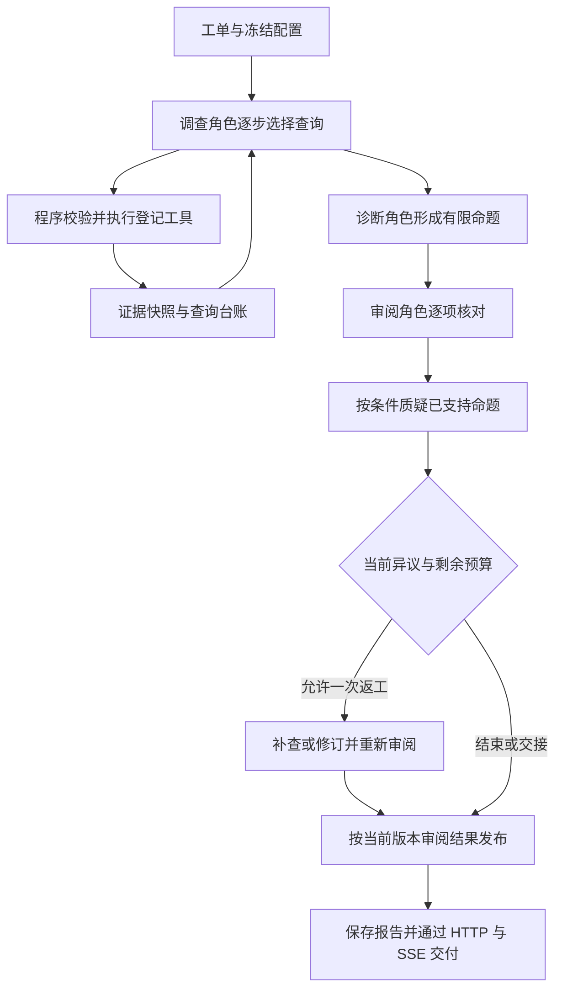

# 架构与代码导览

这是一个故障辅助诊断项目：从工单出发，在授权范围与预算内查询日志、指标、变更和知识资料，形成带证据引用的有限判断，经过审阅后交付报告及人工核查项。完成诊断不自动表示工单已解决，也不自动取得修复执行资格。

## 目录职责

| 路径 | 当前职责 |
| --- | --- |
| [app/api/](../app/api/) | 身份、工单、运行、SSE、手册及修复接口 |
| [app/workflow/](../app/workflow/) | 运行准入、配置冻结、任务执行与存储衔接 |
| [app/workflow/v2/](../app/workflow/v2/) | 自主调查、诊断条目、逐项审阅、挑战、返工和发布 |
| [app/runtime/](../app/runtime/) | 调用／时间／输入预算、运行上下文、schema 辅助和应用指纹 |
| [app/tools/](../app/tools/) | 本地工具契约、参数与范围校验、去重及查询覆盖台账 |
| [app/providers/](../app/providers/) | 登记的观测与历史来源，以及合成演示来源 |
| [app/evidence/](../app/evidence/) | 证据快照、不可变引用、源事实和引用边界校验 |
| [app/knowledge/](../app/knowledge/) | 手册导入、切块、向量索引与检索 |
| [app/agents/models.py](../app/agents/models.py) | 模型客户端及四个角色的构建；角色行为主要位于 v2 模块 |
| [app/storage/](../app/storage/) | 工单、运行、事件和修复记录的持久化 |
| [app/repairs/](../app/repairs/) | 独立的人工批准修复流程；当前演示没有连接真实修复执行器 |
| [front/agent_front/](../front/agent_front/) | Vue 前端，通过 HTTP／SSE 创建、跟踪和回读运行 |
| [scripts/](../scripts/README.md) | 诊断、接入、演示、实验与统计入口 |
| [tests/](../tests/) | 控制逻辑、权限、工具、发布及存储等回归验证 |
| [evals/](../evals/README.md)、[fixtures/](../fixtures/) | 评估协议与结果、Agent 可见观测；答案与输入分离 |
| [archive/](../archive/) | 已退役源码和历史索引；不进入当前运行导入链 |

`.venv/`、`build/`、`*.egg-info/`、前端 `dist/` 是环境或生成物；`output/`、日志和本机凭据由 Git 忽略。正在使用的构建产物、账本与数据库仍有运行用途，不能仅因被忽略而删除。

## 当前怎样编排

当前 v2 使用 [LangGraph StateGraph](../app/workflow/v2/graph.py)管理阶段流转，节点复用既有 Python 业务操作；旧版诊断链路继续归档。[API 适配器](../app/workflow/execution.py)按冻结配置调用[调查引擎入口](../app/workflow/v2/engine.py)，普通后端与统一 CLI 默认使用 `autonomous_v2 / closed_loop`。迁移边界与对照见[迁移说明](langgraph-migration.md)。

| 模型角色 | 负责什么 | 程序保留的控制 |
| --- | --- | --- |
| 调查 `investigation` | 每步选择一个合法查询或结束 | 权限、参数、预算、去重和实际执行 |
| 诊断 `diagnosis` | 根据已取得来源提出有限命题与核查建议 | 源事实生成、引用注册和条目契约 |
| 审阅 `reviewer` | 判断命题的证据支持范围、建议是否适当 | 目标／证据版本绑定、响应校验和发布条件 |
| 质疑 `challenger` | 按条件核对已支持命题是否遗漏来源限制 | 触发条件、总预算与保守降级 |

四个角色可以使用同一个底层模型；不是四套独立常驻服务，也不是每次运行都会调用全部角色。模型判断不能由引用合法或审阅通过替代为因果事实。

## 自主取证与 RAG

模型通过 JSON 决策选择本地 Tools，当前工具接入不是 MCP。服务登记提供可查询指标、单位、日志类别、字段含义、范围及服务端连接配置；具体取证路径由模型结合工单与返回结果选择，不为每个服务预写故障决策树。

`search_runbooks` 是调查阶段可选工具：经登记的 Provider 接入手册检索，使用查询向量和 pgvector 返回范围内片段。历史事故另有检索入口。手册与历史是线索，不能替代当前观测；检索失败、没有命中或存在相似历史，都不直接证明根因。

## 纠正、返工与报告

结构化输出纠正使用 [RunContext.claim_repair](../app/runtime/context.py)；语义返工使用独立的 [claim_rework](../app/workflow/v2/rework.py)。后者最多一轮，共用本次总预算。结论或证据变化后重新审阅，旧批准不能直接继承；只改措辞而没有新观测时仍保留原信息缺口。

[发布逻辑](../app/workflow/v2/engine.py)与[结果分类](../app/workflow/v2/outcome.py)分别处理可交付内容和完成边界。`partial` 仍可生成、保存并返回报告，需结合缺口和中断原因理解。取证、语义支持、交付、人工确认解决与修复执行是不同状态。

实际环境、预算及历史指纹见[当前 v2 导览](current-v2.md)，效果和限制见[评估阅读指南](evaluation-guide.md)。
