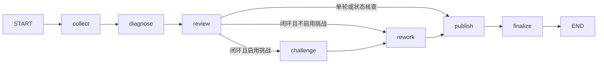

# LangGraph 阶段编排迁移

现有 v2 成果及两项 Linux 评估兼容修复已通过 Git 原生命令快进合入 GitHub `main`。迁移基线是 `05c3014ddba6f2d35f0cb8f7599b5fd35217319a`，三项远端 CI 均通过；回滚标签为 `rollback/pre-langgraph-migration-20261019`。本轮在新分支 `codex/langgraph-orchestration` 实施，不自动合并迁移结果到 `main`。

## 本次实际改变

[engine.investigate](../app/workflow/v2/engine.py)保留原调用签名，转交 [graph.run_graph](../app/workflow/v2/graph.py)。实际阶段由已编译的 LangGraph `StateGraph` 调度，包含以下七个节点：

- `collect` 复用自主只读取证循环；工具选择仍由模型决定，查询范围、去重和执行仍由程序落实。
- `diagnose`、`review`、`challenge` 复用既有条目契约、提示词和版本校验。
- `rework` 复用现有有界返工函数，内部按真实异议及预算补查、修订、重新审阅和条件挑战。即使不执行返工，也保留原有跳过原因和审计信息；路由不重复占用返工次数。
- `publish`、`finalize` 保留原有报告、历史、完成事件及返回格式。

七个节点对应阶段，模型角色仍为调查、诊断、审阅、质疑四个。调查逐步读取和一次语义返工的内部循环保留在原函数中，本轮未把每次模型／工具调用进一步拆成图节点。

## 状态与运行依赖

`GraphState` 保存命题、审阅、失败、纠正计数及报告历史；每个节点显式返回需要更新的字段。默认覆盖这些字段，不对已累计的列表再次使用追加 reducer，避免审计记录重复。

模型客户端、Provider 的执行器、锁、预算、事件回调和调查问题对象保留在每次调用独立的 `Runtime` context 中，不进入图状态或数据库。编译图可以复用，每次运行的上下文与证据台账独立。前端继续读取原有业务 SSE，不直接暴露整个图状态。

第一版明确关闭图 checkpoint，不配置节点自动重试、并行分支或断点续跑。图步数限制只约束阶段调度，模型、工具、输入和时间预算仍以同一个 `RunContext` 为准；原来的有限协议纠正及工具重试保持原规则。

## 怎样证明行为保持一致

迁移前先保存 42 组免费固定轨迹：6 个开发案例、两档预算、单轮／闭环与挑战开关，加上实际修订、撤回、无效修订、重复查询、挑战和状态核查。迁移后逐组比较完整模型输入、工具调用、事件、审阅与返工历史、预算计数及报告。

比较固定时钟和运行 ID，仅忽略随机 span ID 与证据获取时间；观测时间、原始证据、命题版本和报告内容均保留。42 组全部一致。这些是流程行为对照，不是新增模型质量成绩，也不测量真实模型延迟。

新增回归保护实际图路径、异常阶段不自动重试或继续发布、并发运行隔离、共享上下文范围校验。验收详情及当前源码指纹见[迁移验收](../evals/langgraph-migration-validation-20261019.json)。清理前后的历史 Flash 运行仍绑定各自原始源码，不标成图编排后的新运行。

## 合并前发现的跨平台问题

首次推送时，GitHub Linux CI 暴露 v1 冻结评估文件的换行规则缺失、离线复现器用本机路径规则解释 Windows 原始路径，以及生成器依赖系统默认换行的问题。已分别固定 v1 的 CRLF 检出／生成格式，并从原始路径提取跨平台文件名。原始观测、真值、执行证据和冻结哈希未改，业务代码未受这些兼容修复影响。

## 回滚与效果边界

恢复图迁移前基线时，在独立目录检出 `rollback/pre-langgraph-migration-20261019`，按对应文档使用原数据库及账本；不要覆盖当前工作目录或重置模型调用记录。更早的旧版恢复仍按[旧版归档说明](../archive/legacy/README.md)执行。

本轮目标是明确编排边界并保持既有行为。LangGraph 本身不修复证据整合、语义误判或错误因果判断；之前的根因数字继续按[评估阅读指南](evaluation-guide.md)解释。后续若增加恢复、并行或图级重试，需另行验证调用幂等、预算账本及事件去重，不沿用本轮等价性结论。
