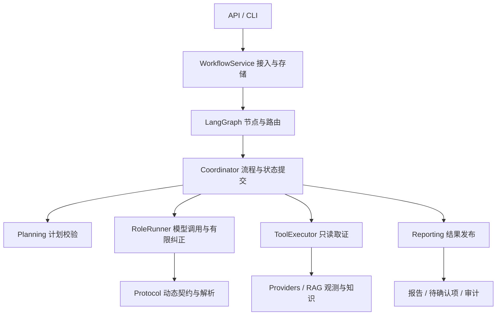

# Agent 架构与职责边界

当前默认链路是三个模型角色与两类程序取证：Supervisor 规划查询，Investigation / Knowledge 执行已校验的只读计划，Diagnosis 形成候选诊断，Reviewer 复核并提出证据缺口。查询完成、报告通过与修复批准是不同状态。

## 运行链路



## 模块如何分工

| 模块 | 职责与接口 |
| --- | --- |
| `app/workflow/coordinator.py` | 保留阶段入口与 `Collaboration` / `collaborate()` 兼容入口。负责下一节点、业务补查提醒、失败交接及跨阶段状态更新。 |
| `app/agents/role_runner.py` | `RoleRequest` 描述单次结构化请求；`RoleRunner` 管理本地消息、调用、验证及有限纠正。通过解析、校验、业务提醒和额度耗尽回调与工作流协作，不持有 Coordinator。 |
| `app/agents/protocol.py` | `RoleContractContext` 提供本次可见证据、引用、工具和问题台账。生成动态输出契约、去除重复 Schema 展示、解析兼容响应及提供角色纠正指令。 |
| `app/workflow/planning.py` | `PlanningContext` 提供校验所需的当前范围、台账与模式。`validate_plan()` 返回标准化决定，检查权限、引用、查询覆盖及补查预算；不执行工具或提交问题状态。 |
| `app/workflow/reporting.py` | `PublicationInput` → `Publication` 发布复核支持的内容；`ReportSnapshot` → 报告。保留暂定原因、待确认建议、未复核观测及缺口，响应与输入审计数据解除可变引用共享。 |
| `app/runtime/context.py` | 原子计数、原始调用与时间预算、纠正额度领取、用量与追踪。所有后续请求仍计入原预算。 |
| `app/tools/executor.py` | 角色工具权限、工单范围、查询去重、查询结果与字段引用台账。 |

动态契约约束模型能选择的编号和参数，程序继续独立校验。有效引用不证明因果成立，Reviewer 的语义判断仍需外部质量评测。

## 状态归属

- Coordinator 保存并提交跨阶段业务状态，LangGraph 状态用于路由投影和并行结果汇总。
- RunContext 管理预算、调用计数及事件发出；事件持久化沿用现有提交顺序。
- ToolExecutor 保存各角色查询台账，现有并行分支隔离和汇总逻辑继续使用。
- RoleRunner 仅管理一次请求的消息历史；业务提醒是否继续由 Coordinator 决定。
- Planning 和 Reporting 使用明确的输入对象。冻结 dataclass 只限制属性赋值，内部映射和模型对象是借用的读取视图，不宣称深层不可变；报告构建会复制公开响应中的可变数据。

首次拆分保留现有取证、复核、诊断包及模式分支。完整 WorkflowState / WorkflowPolicy 和独立 Collection / Review 组件尚未迁移，以避免同一轮同时改变所有状态所有者。

## 兼容与验证

提示词、输出契约、原预算、错误码、Graph 路由及报告字段保持兼容。模型请求失败后的有限纠正与业务补查提醒分开处理，两者均受原预算约束。报告模块不直接改写运行状态，由 Coordinator 显式提交缺口及升级团队。

新增 `tests/architecture/test_workflow_components.py` 验证组件无需协调器即可运行、纠正不能突破原预算、持续无效响应受控退出、计划校验不执行查询、不发布未复核建议，以及响应修改不会影响输入审计快照。

本次本地另保存了重构前的六个脚本案例及一个默认程序取证案例。采用顺序取证，排除随机 UUID、采集时间与耗时后，比较输出、事件次序、动态契约审计、调用计数和停止原因。完整免费回归继续覆盖并行、补查、状态核查和诊断包路径。脚本响应仅验证程序行为，不作为真实模型质量成绩。

```powershell
$env:PYTHONPATH='app'
.\.venv\Scripts\python.exe -m unittest tests.architecture.test_workflow_components
.\.venv\Scripts\python.exe -m unittest discover -s tests -t . -p 'test_*.py'
```

## 面试讲解

“我把模型协议、执行约束和业务流程分开：Supervisor 提出查询，Planning 与 ToolExecutor 校验并执行；RoleRunner 负责结构化调用、有限纠正和审计，Coordinator 决定是否补查及何时结束；Reporting 依据复核结果发布内容。不同层通过明确的输入和回调协作，所有调用共享原始预算。独立复核是职责和上下文分离，同基础模型仍可能出现相关错误，因此我保留单 Agent 对照及外部评测。”
