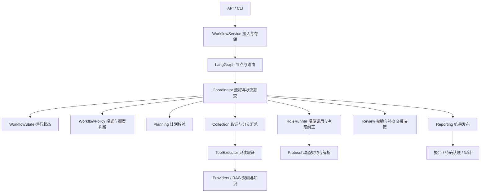

# Agent 架构与职责边界

当前默认链路是三个模型角色与两类程序取证：Supervisor 规划查询，Investigation / Knowledge 执行已校验的只读计划，Diagnosis 形成候选诊断，Reviewer 复核并提出证据缺口。查询完成、报告通过与修复批准是不同状态。

## 运行链路



## 模块如何分工

| 模块 | 职责与接口 |
| --- | --- |
| `app/workflow/coordinator.py` | 保留阶段入口与 `Collaboration` / `collaborate()` 兼容入口。负责下一节点、业务补查提醒、失败交接及跨阶段状态更新。 |
| `app/workflow/state.py` | `WorkflowState` 按控制流、取证、诊断复核和审计分组保存单次运行状态；`graph_projection()` 返回独立的路由摘要，不保存第二份预算或查询台账。 |
| `app/workflow/policy.py` | 冻结的 `WorkflowPolicy` 集中模式、派生能力、原有限次及取证／补查额度判断；`BudgetView` 提供本次决策所需的计数和耗时快照。只判断准入，不领取额度、调用模型或执行查询。 |
| `app/agents/role_runner.py` | `RoleRequest` 描述单次结构化请求；`RoleRunner` 管理本地消息、调用、验证及有限纠正。通过解析、校验、业务提醒和额度耗尽回调与工作流协作，不持有 Coordinator。 |
| `app/agents/protocol.py` | `RoleContractContext` 提供本次可见证据、引用、工具和问题台账。生成动态输出契约、去除重复 Schema 展示、解析兼容响应及提供角色纠正指令。 |
| `app/workflow/planning.py` | `PlanningContext` 提供校验所需的当前范围、台账与模式。`validate_plan()` 返回标准化决定，检查权限、引用、查询覆盖及补查预算；不执行工具或提交问题状态。 |
| `app/workflow/collection.py` | `CollectionRequest` → `CollectionOutcome` 执行程序或兼容 Agent 取证，返回结果、证据与引用台账、查询覆盖和调用统计。`ParallelBatch` / `ParallelOutcome` / `CollectionJoin` 明确分支准备、执行和汇总边界，不持有 Coordinator。 |
| `app/workflow/review.py` | `ReviewContext` 提供草稿目标、证据、问题及查询台账的读取视图。校验目标覆盖、当前支持、反证、缺口归属和查询提示；`ReviewRoutingContext` → `ReviewHandoff` / `ReworkDecision` 决定交接或补查资格，完成门禁返回停止原因。 |
| `app/workflow/routing.py` | 新编排的 `ReviewDisposition` 在有效复核之后返回 publish / revise / collect / handoff / stop；优先关键取证缺口，不从自由文本猜路由，不增加模型角色。 |
| `app/workflow/revision.py` | `RevisionTask` 复制原稿和要求，绑定稿次及证据／查询台账指纹；生成可直接输出的引用选择模板，限制修改范围并拒绝原样修稿，调用前和提交前检查过期。提供机械取证出口判断，不确认语义充分性。 |
| `app/workflow/handoff.py` | 根据已发布内容、未知问题与实际查询台账生成交接材料；包含停止原因、人工待办、登记负责人及操作边界，不增加模型调用。 |
| `app/workflow/reporting.py` | `PublicationInput` → `Publication` 发布复核支持的内容；`ReportSnapshot` → 报告。保留暂定原因、待确认建议、未复核观测及缺口，响应与输入审计数据解除可变引用共享。 |
| `app/runtime/context.py` | 原子计数、原始调用与时间预算、纠正额度领取、用量与追踪。所有后续请求仍计入原预算。 |
| `app/tools/executor.py` | 角色工具权限、工单范围、查询去重、查询结果与字段引用台账。 |

动态契约约束模型能选择的编号和参数，程序继续独立校验。有效引用不证明因果成立，Reviewer 的语义判断仍需外部质量评测。

## 状态归属

- Coordinator 持有一份 `WorkflowState` 并提交跨阶段业务状态，LangGraph 状态用于路由投影和并行结果汇总。
- RunContext 管理预算、调用计数及事件发出；事件持久化沿用现有提交顺序。
- ToolExecutor 保存各角色查询台账。Collection 为并行分支创建独立执行器和 BranchContext，分支只更新自身台账；Coordinator 在汇总校验成功后安装分支执行器、保存任务并合并证据与引用。
- RoleRunner 仅管理一次请求的消息历史；业务提醒是否继续由 Coordinator 决定。
- Review 读取候选与台账，不改写问题状态或执行工具。`ReviewAudit` 保存当前校验的提示拒绝与范围限制；Coordinator 即使在校验异常时也保存这些诊断记录，语义判定和问题台账仅在有效结果返回后更新。
- Planning 和 Reporting 使用明确的输入对象。冻结 dataclass 只限制属性赋值，内部映射和模型对象是借用的读取视图，不宣称深层不可变；报告构建会复制公开响应中的可变数据。

四轮拆分保留原诊断包及模式分支。状态聚合不等于支持持久化恢复；运行中断仍沿用现有 RunStore 失败处理。

## 状态与策略如何配合

| 状态分组 | 保存内容 |
| --- | --- |
| `state.control` | 当前阶段与下一节点、停止原因、调度／补查次数、待补查挑战、有限提醒和协议收尾标志。 |
| `state.collection` | 任务记录、复用记录、聚合证据和引用、派发队列、并行批次与计划、取证退出记录和诊断包状态。角色查询台账仍由 ToolExecutor 保存。 |
| `state.diagnosis` | 当前草稿和复核、证据问题台账、各版历史、独立观测复核、提示审计、交接请求、报告缺口及升级团队。 |
| `state.audit` | 原事件列表、协商记录、调度决定、结构纠正统计和工作流 span。共享 RunContext 时继续使用调用方提供的同一事件列表。 |

每次运行独立创建这些容器。Coordinator 的 `phase`、`tasks`、`draft` 等旧属性通过显式声明的 property 映射到聚合对象，读取、替换和原地修改使用同一份数据；没有 `__getattr__` 猜测映射或影子副本。现有阶段方法、诊断包及直接调用脚本继续兼容。

WorkflowPolicy 只保存原有取证模式、复核保护、纠正模式、并行与盲复核开关。`planning_only` 和 `role_corrections` 根据模式计算。兼容配置赋值会校验并替换冻结策略快照，旧快照保持原值，未登记模式不会部分生效。

Coordinator 从 RunContext 在锁内读取当前计数，构造短期 `BudgetView`；Policy 计算是否可以派发或补查，RunContext 在真实调用时继续原子领取额度。准入结果不会预扣预算，也不替代运行时执行门禁。普通补查保持最多 1 轮／4 次 Supervisor／6 个任务；满足原追加补查资格后最多 2 轮／5 次 Supervisor／7 个任务，总调用和时间上限不增加。两类取证最多并行 2 个角色，补查仍顺序执行。

Graph 投影仅包含路由、数量、证据编号和运行计数摘要；复制列表及计数映射，修改投影不会改写实际状态。并行结果仍通过原有类型化通道返回并在 join 后提交，未把执行器和整个业务状态移入 Graph 存储。

## 取证组件的接口与并行处理

1. Coordinator 根据已校验任务建立 objective，决定顺序执行还是并行执行；补查继续顺序执行。
2. Collection 接收规范化参数，包括工具参数默认值。程序模式只执行明确的 `required_checks`，保留重复、失败、空结果和截断的查询状态，不自行解释故障原因。
3. 并行准备阶段按固定角色顺序分配原预算内的额度，复制 objective 并 fork 执行器台账。创建分支不消耗调用次数，也不扩大总预算。
4. 每个分支返回 `ParallelOutcome`。结果对象包含任务结果和该分支执行器；证据、字段引用、查询结果及覆盖来自同一个台账，避免另存一份可独立修改的查询状态。
5. `join_parallel()` 在任何共享状态提交前检查角色集合、批次和请求／执行器归属，按稳定顺序返回 `CollectionJoin`。它不安装执行器，不写入跨阶段状态。
6. Coordinator 提交各分支记录和证据，再根据原规则继续调度、转入诊断或停止。失败分支保留已取得的证据；只有历史知识时仍不能形成当前故障诊断。

内部 Graph 结果通道使用类型化分支结果，未引入 checkpoint 或跨进程序列化。请求和执行器归属校验针对同一次进程内运行；公开报告和持久化事件仍使用原 JSON 格式。

## 复核组件的接口与决策

1. Coordinator 组织原 Reviewer 输入，通过 RoleRunner 取得输出，将当前证据、目标、问题与查询台账作为 `ReviewContext` 交给校验函数。
2. 校验函数返回规范化的 `ReviewDecision`，保留不确定性、原错误码及审计顺序。核心问题的阻塞属性仍由程序固定；历史知识不能单独建立当前原因，弱反证继续保留为未知。旧 blocker 推导的补查请求须重新通过同一校验。
3. 未登记、越界或已覆盖的查询提示记录在 `ReviewAudit.hint_status`，不执行查询，也不丢弃合法证据缺口。后续校验失败时，已产生的审计诊断仍由 Coordinator 保存。
4. Coordinator 根据有效复核结果更新问题台账。`resolve_handoff()` 只有在当前机制、有效下一步及必要覆盖无关键缺口时才返回非关键触发原因的人工交接；原请求与未确认原因继续保留。
5. 对仍需补查的请求，`decide_rework()` 按协议收尾、补查轮次、追加补查资格、原预算的顺序返回决定。额度计算由只读回调提供，组件不领取预算或派发任务。
6. Coordinator 保存交接／补查事件及下一节点。完成门禁仍区分诊断不完整、复核不完整、状态核查完成与普通完成，修复审批链路保持独立。

复核组件不持有 Coordinator；审计回调只发布原有事件，显式审计对象收集诊断效果。冻结视图中的映射和模型是借用的读取对象，不宣称深层不可变。程序保护不证明自然语言因果判断正确。

## 兼容与验证

### 复核驱动编排试验

`Collaboration(..., orchestration='legacy')` 和 `collaborate()` 默认兼容旧路径；`orchestration='review_driven'` 要求两类取证均为 programmatic。API 的 DiagnosisRequest 可显式选择新流程，仅适用于 live；前端提供同名含义的试验选项，改变选择后须重新确认付费额度。标准请求序列化时省略 legacy 参数，旧 pending 请求和已有 request_key 不因默认字段增加而失去幂等性。新模式与预算作为启动请求一起保存，重放时不能换模式。

新路径为 Supervisor → 受限取证 → Diagnosis → Reviewer → 程序分流。取证取得当前观测后通常直接诊断；没有当前观测但还有未尝试的工具渠道与额度时，最多进行一次额外初始规划。这是工具 Schema 层面的候选渠道，并不证明来源可用或查询有语义价值；原权限及执行器检查继续适用，不能只有历史知识就进入当前故障诊断。

Reviewer 使用 `RevisionReviewDecision`，继承旧判定和证据缺口契约，只增加小型 revision_requests。已有证据可修正的 H/A 表达或推理问题须指向实际的 uncertain / not_supported 目标，不能一边 supported 一边请求修稿。模型不选择最终路由，也不规划查询参数。标准模式继续使用原 ReviewDecision，旧 Schema 和报告不增加空修稿字段。

分流优先级：协议／执行失败受限退出；关键证据缺口优先补查；授权范围外信息、无有效计划或额度不足交接人工；只有已有证据下的表达／推理问题才纯修稿；完成门禁通过后发布。混合反馈把修稿要求并入补查后的新稿，不额外先生成一个纯修稿版本。非关键 trigger 未知满足原门禁时可发布带限制报告，原未知和请求保留。

常规纯修稿全运行最多一次，不执行工具、不领取新预算，保留关键问题和原始证据。非目标 H 的纠错提案经 Reviewer 独立裁决，可另授权最多一次范围纠错，计入 `scope_revision_rounds` 并受原预算门禁约束。新稿清除旧复核并完整复核全部新目标。RevisionTask 在调用前、提交前核对稿次与台账指纹；补查请求也绑定原稿和台账，在规划及派发前校验。全运行角色纠正额度不因稿次重置，split Reviewer 继续使用原 ReviewDecision 纠正槽位。

纯修稿采用独立的 Diagnosis 系统提示和程序生成的 `output_template`，模板使用实际 REF 选择项而非展开后的来源对象。F/H/A 的数量和顺序不变，未指定条目逐字段保留，每个指定目标必须发生内容修改；表达修稿还锁定行动执行类型／checks／repair／审批要求和假设层级／引用／pending_checks。动态 Schema 暴露相同范围，服务端候选校验独立执行。越界或空修稿通过原有一次纠正槽处理，持续无效候选不提交，不能借行动隔离回调保留部分稿。补查后的新证据稿继续完整重建，不套用纯修稿冻结规则。

新编排的复核范围校验拒绝将仅关联 trigger 或已支持待办的未知项用作 symptom／mechanism／alternative 的阻塞理由，输出精确归属诊断让 Reviewer 独立重评。该门禁只识别结构矛盾，不自动将未知改为 supported，也不确认语义正确性。标准模式保留原保守兼容规则；具体问题、失败记录和真实复验见[修稿探针分析](revision-probe-followup.md)。

`RevisionDiagnosisSelection` 允许对非目标 H 提交 `revision_concerns`；候选稿如仍改动非目标 H，程序恢复原值并隔离为提案，不能借此修改非目标 A、增删候选或放宽执行门禁。提案验证引用，绑定实际稿次及台账指纹，再交给 Reviewer。`scope_assessments` 必须覆盖提案；keep 要求原 H 受当前观测支持，revise 要求未支持目标、当前证据及 reasoning 修稿请求，evidence 必须关联真实缺口。程序据有效裁决控制一次范围扩展，提案自身不成为结论或授权。

新模式的 `RevisionNeedAssessment.gap_kind` 明确区分 `evidence`（默认，缺新观测）与 `revision`（已有观测、论证待修正）。revision 保持 uncertain，必须关联未支持的 revision_targets、已有修稿请求和当前 EV，不能同时声明 blocker 或相关补查。程序仅将这个有效待修稿问题送往编辑；问题台账仍未关闭，新稿需要完整复核，不能直接发布。真实证据、任务和观测缺口继续优先。标准模式的 NeedAssessment、ReviewBlocker 和原门禁不增加这类标记。详细流程与后续验证见[范围冲突优化](revision-scope-conflict.md)。

普通补查及追加补查资格沿用原上限；已有合法未执行计划可复用，仍占用调度位置但不调用规划模型。补查之后直接重新诊断；失败、已执行或已覆盖查询不能伪装成新增信息。新预算按规划、可能的查询 Embedding、诊断、复核与纠正预留计算，移除旧取证解释阶段；并行纯程序分支允许零模型额度，真实模型调用仍受分支及总额度约束。Embedding 按工具允许的两次尝试保守预留，不能消耗受保护的收尾额度。

交接材料保留已支持内容、待确认建议、未知问题、实际查询状态、停止原因和人工待办；只使用实际取得的 team 作为接手方，没有负责人时明确未解析。关键缺口保持 partial，非关键未知交接沿用带限制完成语义。生成交接不发送通知、不批准操作、不关闭工单。

新增 `tests/workflow/test_review_driven.py` 覆盖直接诊断、纯修稿、持续修稿退出、混合补查／修稿、外部信息交接、低预算、过期稿次／台账、无观测出口、程序并行和 split 纠正槽位。API 回归验证选择保存、不可改变重放模式及旧请求格式；`tests/evals/test_review_driven_validation.py` 验证默认无模型、跨角色请求上限和跨批次计数一致性。

当前固定脚本案例中，新路径 3 次模型调用、旧路径 4 次，查询及最终 output 相同；一次纯修稿为 5 次模型调用、2 次工具调用，两稿均独立复核。这是程序控制成绩，不能外推真实模型质量或实际延迟。最终免费回归 703 项，683 通过、20 项数据库检查跳过、0 失败；标准路径的 15 个历史行为基线继续一致。前端类型与生产构建通过。数据库集成未在本轮重新执行，不借用旧版本成绩算本轮通过。

真实验证入口：`scripts/verify_review_driven.py`，默认只生成计划，`--execute-live` 才调用配置模型。两个冻结场景每个版本每条路径一次，并交替顺序；另一个探针预置草稿与修稿反馈，后续 Diagnosis / Reviewer 调用真实模型，明确标记 seeded_feedback，不计入自主效果。每条运行最多 12 模型／8 工具／300 秒，总付费请求尝试最多 50；后续版本通过 previous-summary 校验历史计数并继承总上限。保存全部响应、失败、源码／脚本／数据指纹和报告哈希，不挑选成功替换失败，不混合版本算准确率。

2026-10-15 两批真实验证使用 qwen3.7-flash，共 50 次模型请求尝试，其中 2 次连接失败未取得模型回复，费用未知；无真实修复或业务数据库写入。完整机器摘要与报告哈希见 [review-driven-validation.json](review-driven-validation.json)。首批新路径和修稿探针均暴露“目标判为 supported 又请求修稿”的契约矛盾；保留原失败后补充精确字段定位和程序固定核查说明的提示，未放宽判定或引用检查。

最终源码 `6930a3b322f48a71` 的同版本结果如下；它们是已用于开发的固定案例，不是独立准确率成绩。

| 场景 | 标准路径 | 新路径 | 解释范围 |
| --- | --- | --- | --- |
| fresh_001 磁盘案例 | partial / MODEL_OUTPUT_INVALID，8 模型、4 工具 | completed / FINISHED，8 模型、3 工具，1 轮补查 | 新路径取得资源日志并支持空间耗尽机制，触发来源仍未知；实际计划不同，不能单独归因于省调度或宣称质量提升。 |
| fresh_003 日志渠道失败 | partial / NEEDS_INFORMATION，7 模型、4 工具 | partial / REVIEW_INCOMPLETE，8 模型、3 工具，1 轮补查 | 新路径保留未知机制、失败渠道及具体人工获取日志的交接；没有在该场景减少模型调用或耗时。 |
| 预置修稿反馈探针 | 不属于完整配对 | 纯修稿 1 次，后续请求补查，最终达到跨批次付费上限 | 种子草稿／反馈不能作为自主效果，最终复核未完整通过；源码报告中的 model_calls 包含脚本请求和被总上限拒绝的已领取调用，真实请求单独统计为 paid_attempts。 |

该 50 次对照验证会话的首批与最终批次、全部成功／partial／失败均保留，未突破会话上限。用户随后授权继续分析并定向复验，另设每场景 8 次、累计 24 次的修稿会话，跨实现修复继承已用计数并保留中间失败，见[后续记录](revision-probe-followup.md)。当前结果不足以证明总体质量、成本或延迟收益，因此新编排保持显式试验选择，标准流程不切换默认。

提示词、输出契约、原预算、错误码、Graph 路由及报告字段保持兼容。模型请求失败后的有限纠正与业务补查提醒分开处理，两者均受原预算约束。报告模块不直接改写运行状态，由 Coordinator 显式提交缺口及升级团队。

新增 `tests/architecture/test_workflow_components.py` 验证组件无需协调器即可运行、纠正不能突破原预算、持续无效响应受控退出、计划校验不执行查询、不发布未复核建议，以及响应修改不会影响输入审计快照。

第二轮新增 `tests/architecture/test_collection_component.py`，覆盖无模型程序取证、复用不增加调用、objective 快照隔离、分支台账不提前安装、汇总顺序及批次校验、来源失败与异常脱敏、原始收尾预算，以及执行器／上下文不匹配拒绝。

第三轮新增 `tests/architecture/test_review_component.py`，验证复核不修改候选、问题或调用计数，未知引用与目标缺失拒绝，核心阻塞保留，失败校验保留提示审计，范围解绑不提升判定，以及关键缺口交接、追加补查和完成门禁。

第四轮新增 `tests/architecture/test_state_policy.py`，覆盖跨运行可变状态隔离、兼容属性的唯一数据归属、共享事件列表、Graph 投影隔离、实时预算读取、冻结策略替换及派生模式一致性，以及各个调用／工具／时间／补查限次门槛和收尾保留。

本次本地另保存了重构前的六个脚本案例及一个默认程序取证案例。采用顺序取证，排除随机 UUID、采集时间与耗时后，比较输出、事件次序、动态契约审计、调用计数和停止原因。完整免费回归继续覆盖并行、补查、状态核查和诊断包路径。脚本响应仅验证程序行为，不作为真实模型质量成绩。

第二轮另外保存四个并行／失败基线：兼容 Agent 并行、默认程序并行、Investigation 失败、Knowledge 失败。比较时排除随机编号和时间，并按内容比较并发事件集合；真实并发、事件汇总顺序和角色调用归属由既有屏障测试验证。

第三轮另保存四个复核／交接基线：非关键 trigger 交接、关键机制未确认、低预算退出与无效引用。排除随机编号和时间后，比较发布结果、审计事件顺序、调用计数和停止原因，同时继续核对前两轮的顺序及并行基线。

2026-10-15 第三轮验证：45 项针对性回归和 10 项新增边界测试通过；全量 668 项，648 通过、20 项数据库集成检查跳过，0 失败。15 个固定案例通过上述基线对照。首次全量测试停在 Windows asyncio 的本地 socketpair 初始化；不加载项目代码的独立探针在沙箱内同样阻塞，允许本机回环后成功，完整回归随后在允许回环的环境通过。没有为此修改项目或测试逻辑；数据库跳过项不计为通过，控制成绩不代表真实模型诊断质量。

2026-10-15 第四轮验证：14 项新增状态／策略边界测试和 31 项针对性回归通过；全量 682 项，662 通过、20 项数据库集成检查跳过，0 失败。前述 15 个固定案例继续通过基线对照。完整回归使用允许本机回环的环境，没有调用付费模型或真实修复服务。本轮验证程序行为兼容及状态归属，不证明真实模型质量或断点恢复能力。

```powershell
$env:PYTHONPATH='app'
.\.venv\Scripts\python.exe -m unittest tests.architecture.test_workflow_components
.\.venv\Scripts\python.exe -m unittest tests.architecture.test_collection_component
.\.venv\Scripts\python.exe -m unittest tests.architecture.test_review_component
.\.venv\Scripts\python.exe -m unittest tests.architecture.test_state_policy
.\.venv\Scripts\python.exe -m unittest discover -s tests -t . -p 'test_*.py'
```

## 面试讲解

“我把模型协议、执行约束和业务流程分开：Supervisor 提出查询，Planning 校验计划，Collection 组织受限取证，ToolExecutor 校验并执行工具；RoleRunner 负责结构化调用、有限纠正和审计，Review 检查复核结果、缺口和补查资格。Coordinator 根据 WorkflowPolicy 做额度判断，将有效结果提交到 WorkflowState 并推进阶段；RunContext 负责真实调用时的原子预算执行，Reporting 依据复核结果发布内容。并行分支使用独立台账和共享总预算，汇总节点统一提交状态。独立复核是职责和上下文分离，同基础模型仍可能出现相关错误，因此我保留单 Agent 对照及外部评测。”
