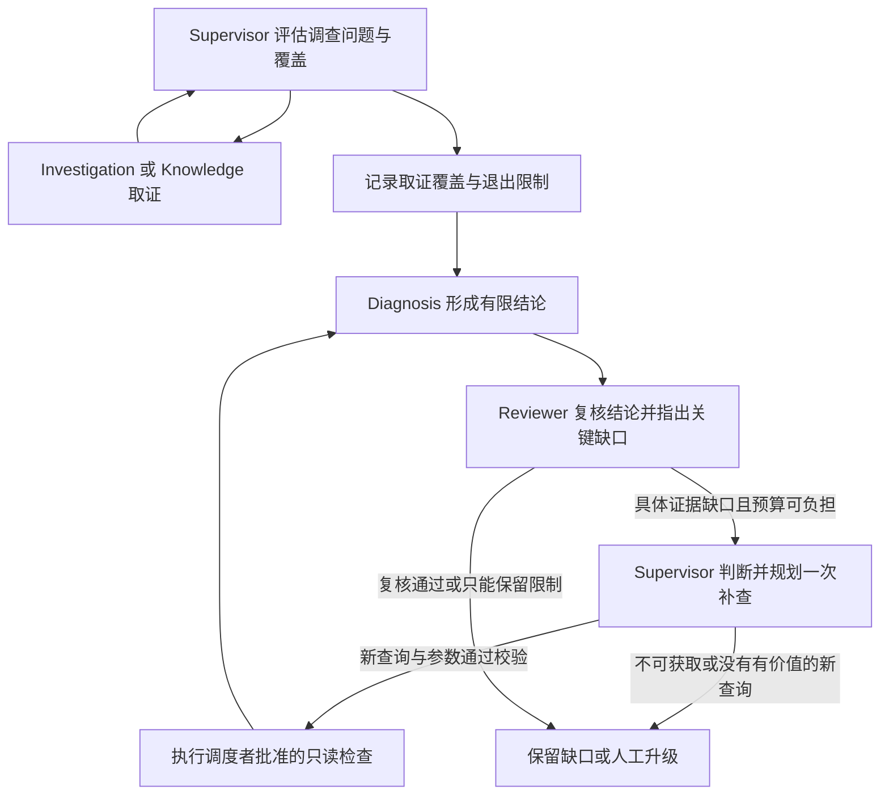

# 调查覆盖与复核缺口调度

2026-10-11，工作流版本 `incident_graph_v3_coverage_rework_planning`。

## 调整目的

聚焦查询仍是执行方式，但取证退出需要解释症状、机制和合理替代解释的覆盖情况。Reviewer 可以准确指出证据缺口，却不一定擅长设计下一项查询，因此将具体补查规划交还 Supervisor。

本次不更换基础模型，不扩充工具或案例，不修改单 Agent、观测登记、前端审批和执行器。历史评测及冻结数据保持原样，没有付费模型调用。

## 执行流程

### Reviewer

`request_evidence` 必须关联已有 N 问题或 H/A 目标，明确 `missing_observation`。可以不提供 H 编号、证据编号和工具参数；不能编造引用。`checks`、`target_role`、`proposed_check` 与 `expected_value` 只是可选查询提示。

可选提示仍检查登记能力、时间、角色及已有查询覆盖。重复或非法提示通过 `review_hint_ignored` 记录并移除，不把合法的证据缺口一起丢弃。没有具体查询不再自动等于“只能人工执行”。明确人工实验或渠道不可用时，仍可用 `follow_up_reason` 保留限制。

### Supervisor

接收缺口、已有证据、查询记录、提示拒绝原因、登记能力和预算；可以更换建议中的角色、渠道及参数。选择执行时，必须提供一个角色、一到两个具体检查和 `expected_value`，说明查询如何回应缺口。

补查计划逐项检查权限、范围与新增覆盖；重复查询不能混在一个新查询后获得批准。全部检查必须能在原工具预算内完成，并保留解释、诊断和复核额度。规划调用已经发生后不会再次预扣同一次 Supervisor 调用。

通过校验后记录 `rework_plan_approved`，冻结该调度计划为 `approved_checks`。Investigation 仍不能换成其他工具或跳过批准检查。最多四次有效调度、六个任务、一轮补查和一次结构修复的总约束保持不变。

无法补查时明确请求信息或升级；预算不够则保留已有报告，以 `REVIEW_INCOMPLETE` 收尾，同时记录 `BUDGET_EXCEEDED` 补查拒绝，不发起无法负担的调度调用。

### 取证完整性

复用已有 N 台账，不新增固定的“所有工具必查”清单。症状、机制和合理替代解释先逐项评估；影响下一步的触发原因、操作条件继续纳入问题台账。聚焦少量查询不能代替覆盖判断。

Supervisor 准备进入诊断时，若关键问题仍待评估，或者声明检查仍有缺口，并且预算允许，最多获得一次覆盖提醒。提醒允许选择新检查、依据已有证据评估问题，或明确不可获取，不能强制所有问题标成 supported。

所有进入 Diagnosis 的路径均记录 `collection_coverage_gate`，结果中的 `collection_exits` 保存各稿退出时的问题状态、声明检查缺口和有限收尾原因。尚未处理的关键 pending 问题转为 deferred 并说明规划或限次限制；不会转成 supported，也不会伪称数据源不存在。失败、无进展及预算退出仍保留当前证据进入有限诊断，不重启失效的调度者。

Reviewer 后续可以根据实际证据独立解决这些问题，也可以保持不确定；关键缺口仍阻止报告完成。渠道缺失或日志没有记录原因本身不算漏查，未知非关键触发原因也不自动否定有条件建议。

## 免费验证

- `tests/workflow/test_gap_handoff.py`：9 项新控制场景，覆盖无工具参数的缺口、仅 N 编号的缺口、替换合法 Knowledge 提示、过滤非法提示、拒绝重复/越界调度计划、不可获取与小预算收尾、覆盖提醒后补齐日志渠道。
- 全量回归运行 365 项：358 通过、7 项按环境条件跳过；随后新增的角色替换场景单独通过。当前 366 项测试中的执行验证覆盖 359 个通过项与 7 个跳过项，未将跳过计为通过。
- 三条既有免费脚本演示通过，仍是脚本模型、合成观测与真实图/执行器，不是模型推理质量成绩。
- 串并行取证及公开闭环展示继续使用免费脚本验证，输出写入本地忽略目录。

这些测试证明新的交接、预算、覆盖记录和拒绝分支可运行。它们不证明真实模型一定识别所有关键问题、正确判断因果，或多 Agent 已经优于单 Agent。新版真实对照尚未执行。

## 主要源码

- `app/agents/contracts.py`：缺口请求与可选提示契约。
- `app/agents/prompts.py`：调查覆盖、复核与调度职责。
- `app/workflow/coordinator.py`：提示过滤、补查规划校验、冻结执行、覆盖退出记录与预算。
- `app/workflow/graph.py`：新版工作流标识，原 LangGraph 编排继续复用。
- `app/agents/scripted.py`：适配新协议的免费响应回放；无预设计划时明确保留缺口。

运行中的后端需要重启后加载新版 Python 代码。已有结果保留原工作流版本，不重新解释为新版结果。

## 随后的单次真实模型验证

用户授权后，只运行一次 show_101 多 Agent，qwen-turbo、16模型/8工具/180秒上限，观测为冻结的合成数据，没有改案例或自动重跑。实际11模型/2工具、43.516秒、66477个已知Token，费用未知；结果 partial / needs_information。

Reviewer的无工具参数缺口成功交给Supervisor；程序提醒关键覆盖缺口并拦截重复补查。Supervisor仍没有选到有区分价值的新渠道，纠正后在返工阶段选择diagnose，被阶段门禁拒绝，终止码DIAGNOSIS_WITHOUT_OBSERVATIONS的命名也不准确，因为当前观测确实存在。

离线读取冻结观测确认：关键HTTP400记录在dependency类别，其结构化error_code为REMOTE_SCHEMA_REJECTED，UNKNOWN_FIELD出现在正文；初始声明却在configuration类别按UNKNOWN_FIELD过滤。缺口不是数据源缺失，查询规划仍未改善到足够水平。

公共机械评分5/6通过；references_valid=false实际源于最终聚合10项缺口超过旧评分投影的8项上限，直接findings引用校验通过。保留原始报告及原分数，不宣称6/6。无额度、鉴权或网络错误，没有真实写操作。本次证明缺口交接实际运行，未证明有效补查或总体诊断质量提升；新版本单双配对仍未执行。

## 补查退出错误修正

随后修正了已确认的阶段退出错误：当前已有观测，但 Supervisor 在返工阶段选择 diagnose 时，不再误报 DIAGNOSIS_WITHOUT_OBSERVATIONS，也不重复进入 Diagnosis/Reviewer。保留已有诊断、复核和未解决的缺口，以 partial / needs_information 收尾，终止原因和 rework_denied 事件码均为 REWORK_NOT_EXECUTED。确实没有观测时仍使用 DIAGNOSIS_WITHOUT_OBSERVATIONS。

本次免费回归 37 项全部通过，覆盖直接退出、重复计划被拒绝后退出、真正无观测，以及原有预算、范围和协议修复分支。未再次调用真实模型，未改写上述历史报告，也不将退出修正视为取证质量改善。

## 查询过滤摘要补齐

执行器的 query_profile 现在包含经参数校验的日志 error_code；未设置时保留 null，表示未按错误码过滤。工具事件和现有 collection 透传路径将该字段交给 Supervisor、Diagnosis、Reviewer，也用于 Investigation 的历史查询摘要。不从用户正文推断错误码，不改变实际查询条件或去重规则。

本次免费回归 36 项全部通过，验证具体错误码、未过滤状态、非法参数清空摘要，以及过滤条件进入角色输入与审计事件。未付费调用模型；历史运行报告保持原样。该改动改善查询范围的可见性，不保证模型能够正确选择下一步查询。

## 补齐后的单次真实验证

再次获得用户授权后，沿用冻结 show_101，仅执行一次多 Agent。实际模型9次、工具2次、45.235秒，结果 partial / not_performed，终止 MODEL_OUTPUT_INVALID，失败节点 Reviewer。无额度、鉴权或网络错误，没有自动重跑。

日志事件已包含 error_code=UNKNOWN_FIELD，但 Supervisor 仍未选择新渠道或放宽过滤。Reviewer 两次输出均在两处枚举校验失败，一次纠正额度用尽；脱敏日志未保存具体错误值，不能可靠还原具体字段。本次未进入补查阶段，因此没有真实触发新的补查退出分支，也不能据此宣称取证质量改善。原始报告与分析保存在本地 output/live-coverage-check/3f18011f-a452-457e-8da4-8992ea5fc70b。

## 结构校验失败定位

validation_failure 现在保留固定契约字段路径与数组下标；未知字段名继续脱敏。枚举错误增加 actual 和 allowed：actual 仅允许明确白名单中的状态/角色/调度词，其余值统一显示 <redacted>；allowed 从可信的静态 Pydantic 契约读取，不输出异常的原始输入、上下文或全文。

协作角色失败事件还包含 attempt（当前角色请求内的回复次数，包括纠正或澄清）、model_call_index（本次运行的模型调用序号）、repair_count（失败当时全运行已用纠正次数）、schema_name 和 schema_version（静态契约指纹）。run_id 和 role 沿用现有事件字段。新细节也进入既有的一次纠正提示，预算和纠正上限不变。没有保存原始模型回复；历史脱敏信息不能事后还原。

tests/workflow/test_validation_diagnostics.py 使用本地错误响应验证定位、状态枚举、嵌套可选契约、敏感文本脱敏和连续两次失败的关联，不代表本次真实失败值就是 pending。

## 日志改造后的单次真实验证

获得用户授权后再次执行一次 show_101 多 Agent，模型10次、实际工具读取2次、47.172秒，结果 partial / needs_information，终止 REWORK_NOT_EXECUTED。Reviewer 本次一次输出通过契约，但 Supervisor 补查计划仍被 DUPLICATE_TOOL 拒绝。新增诊断事件成功记录 supervisor、第9次模型调用、首次回复、已用纠正0次及 SupervisorSelection 契约指纹；纠正后按新的有限收尾分支退出，保留诊断与复核。

未出现枚举错误，因此 actual/allowed 的真实展示尚未触发，不能据此宣称历史 Reviewer 枚举失败已根治。查询规划仍未改善。无额度、鉴权或网络错误，无自动重跑。原报告及分析保存在 output/live-coverage-check/f9f72ed7-7833-4336-bfac-b22d48884195。

## 通用日志查询决策调整

Supervisor、Investigation、Reviewer 区分用户报错词、日志正文与结构化 error_code：没有来源字段依据时首次省略错误码及不必要的级别过滤；来源确认后仍可聚焦。受限查空时重新检查过滤假设，Reviewer 优先提出缺少的观测，Supervisor 独立选择放宽或其他有区分价值的登记渠道。不写入特定展示案例的类别或答案，不强制遍历所有渠道。

程序按实际读取台账生成 log_query_feedback，提供查询范围、完整性、限制、错误码是否已在当前日志字段中出现，以及同类别同窗口移除可选过滤的未完成 broader_checks。提案不自动执行、不扩大权限或窗口、不推断原因。已被完整未过滤查询覆盖的旧限制不重复进入反馈，原事件继续留在 collection；普通未过滤样本也不重复展开。反馈最多保留四项，不提高模型输入或调用预算。

首次查询的字段依据由模型判断，程序不声称能够证明每个过滤条件的语义合理性。现有重复/越界/预算门禁继续执行。只对多 Agent 工具说明增加错误码语义，保留单 Agent 原系统提示词及工具参数契约。

tests/workflow/test_log_query_planning.py 提供五项免费控制测试：错误词只在正文、合法来源错误码、真正完整查空、失败/截断、读取反馈后放宽并复核的链路。这些测试不计为真实模型质量成绩。

本次最终全量回归379项：372通过、7项环境跳过。新增信息曾触发旧流程输入上限，已压缩重复提示并省略被完整未过滤查询覆盖的旧限制，未提高预算；原有串并行、负责人引用与返工流程恢复通过。

随后仅运行一次真实show_101多Agent：13模型/4工具/42.437秒，partial / not_performed，MODEL_OUTPUT_INVALID。首次Supervisor仍猜测错误码，但Investigation在空结果后实际去掉错误码和级别，取得此前漏掉的INFO配置日志，Diagnosis据此形成编码器版本不匹配的暂定机制。未查到dependency直接拒绝记录，仍没有完整复核。

Reviewer触发REQUIRED_EVIDENCE_NEED（核心symptom/mechanism不能not_required或blocking=false），全运行一次结构纠正已被前面Investigation的引用格式失败使用，故无法再次纠正。该业务门禁目前没有细节，无法进一步还原具体字段；不宣称问题根治。无额度/网络错误、无自动重跑。原报告与分析在output/live-coverage-check/fd8e7aa9-b334-498e-9bfe-f8944f8cfa8b。
