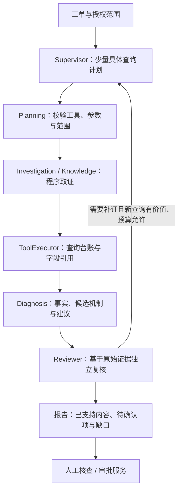

# 面试展示版本：架构与执行流程

当前分支为 `codex/interview-consolidation`，基线为 `fc01b2b`。保留基础模块拆分、pgvector手册检索、审批执行和标准诊断流程；通用修复仅保留输入额度配置、参数错误定位及可选模型超时。实验代码和完整失败历史位于 `codex/review-driven-orchestration`，实验结论不能当作当前版本成绩。

随后只追加[五个局部文件的最小修复](interview-minimal-repairs.md)：引用位置、查询任务标识和阻塞／支持降级反馈；不增加模型角色或编排层。

## 一句话介绍

这是一个以结构化计划驱动的运维诊断辅助系统：模型决定查什么、形成什么候选解释、还缺什么证据；程序负责受控查询、证据引用、预算和审批边界。它辅助调查与交接，最终原因和服务变更仍需要证据或人工确认。

## 执行主线

默认只有Supervisor、Diagnosis、Reviewer三个模型角色。Investigation和Knowledge是两类程序执行模块，执行Supervisor已规划并校验的只读检查；它们不是两个额外自主决策模型。Knowledge按需检索手册与历史材料，历史相似性不能单独证明当前根因。

三个角色默认使用同一模型配置，按职责分别组织请求；独立角色复核不等于盲审或独立评测。Supervisor通过结构化计划表达工具意图，实际工具调用由程序执行。

常规最多一轮补查；额外一轮须满足现有区分价值、新查询和预算门禁。格式失败使用各角色既有一次纠正额度，不开启无限重试。预算不足或证据不足可以以partial结束。

## 模块职责

| 模块 | 负责什么 | 边界 |
| --- | --- | --- |
| API / WorkflowService | 身份、工单、运行创建、存储和异步执行 | 不替模型判断因果 |
| Graph / Coordinator | 阶段衔接、状态提交、调用其它模块 | 保留集中协调，尚未实现检查点恢复 |
| State / Policy | 单次运行状态、只读决策视图、预算准入 | 实际额度由RunContext原子领取 |
| RoleRunner / Protocol | 模型调用、动态契约、解析和有限纠正 | 不执行工具、提交服务变更 |
| Planning / Collection | 校验具体计划，执行取证及并行汇总 | 并行分支隔离台账，汇总后统一提交 |
| ToolExecutor / Providers | 范围、角色权限、去重、原始观测和字段引用 | 失败或空结果不等于服务健康 |
| Review / Reporting | 目标覆盖、支持范围、补查资格和报告发布 | 结构有效不等于语义正确 |
| Repairs服务 | 登记操作、人工审批、执行和恢复验证 | 报告支持建议不构成变更授权 |

## 面试时值得展开的技术点

1. **受控工具调用**：Supervisor输出登记工具与精确参数，执行前检查工单服务、环境、时间窗口和角色权限。日志类别必填，未过滤只表示不限定level/error_code。
2. **证据可追溯**：事实和候选解释引用服务端生成的字段来源；复核看到原始观测和真实查询状态，不能只采信上游角色摘要。
3. **有限闭环**：Reviewer可以要求补查，但新查询须有区分价值并通过预算门禁；重复查询复用台账，所有模型纠正计入原额度。
4. **模型与程序分工**：程序保证身份、范围、引用和计数等可确定的约束；因果关系、竞争解释和建议价值仍由模型判断，不能包装成程序证明。
5. **知识与操作边界**：pgvector检索提供历史背景；人工审批和登记执行器承担变更流程，诊断阶段不会因模型说“通过”自动操作生产服务。

## 90秒讲解示例

“项目解决的是运维调查里观测来源分散、查询重复，以及结论缺少依据的问题。我用Supervisor先形成具体只读计划，由程序校验范围并执行；Diagnosis把观测转成事实、候选机制和下一步，再由Reviewer直接核对原始证据。复核需要补查时，程序检查是否有新信息以及是否留足收尾预算，无法继续就输出明确缺口并交给人工。

“架构上我把模型调用、计划校验、取证、复核和报告拆开，运行状态与预算分别有明确所有者。后续曾尝试更复杂的修稿仲裁，真实模型验证没有证明稳定收益，所以保留失败记录，把展示主线收敛到基础架构。当前可展示控制流程、来源追踪和审批边界；真实根因准确率仍需要更独立的数据验证。”

运行方式、回归及本轮真实模型结果见[收敛交付记录](interview-consolidation.md)。历史完整模块说明见[基础架构](architecture.md)。
