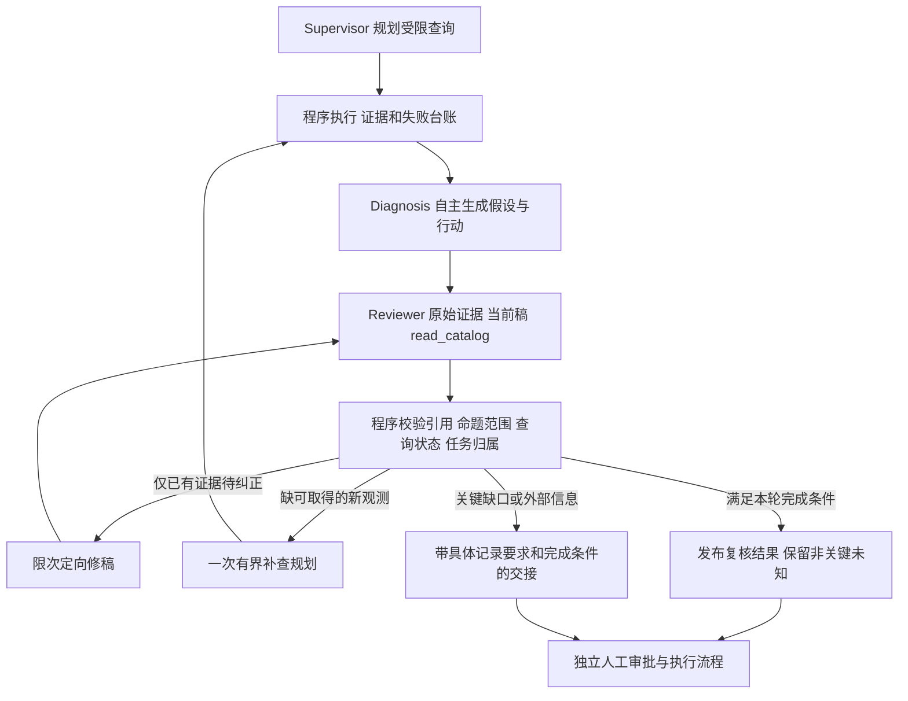

# Reviewer 反证、语义范围和人工交接收尾

本轮完善显式启用的 `review_driven`，标准 `legacy` 仍为默认。应用实现先提交 `6e04ca3`，新案例与验证协议后提交 `799b29a`。应用字节指纹 `e58ec12322a023da`。不将内部 `passed` 等同于根因正确，也不将人工待办等同于授权或工单解决。

## 模块职责与执行路径

| 模块 | 职责及边界 |
| --- | --- |
| `agents/contracts.py` | 仅扩展新路径复核契约：命题反证、查询状态断言、人工核查任务；标准 ReviewDecision 保持原样 |
| `workflow/coordinator.py` | 按策略装配角色输入和动态 schema；新 Reviewer 接收原始来源、当前稿、查询目录；协调已有预算和有限纠正 |
| `workflow/semantic_scope.py` | 生成稳定 read_id 和查询覆盖状态，校验命题原文、真实字段、任务归属与台账一致性；生成带来源的展示信息 |
| `workflow/review_protection.py` | 新路径不允许用一条局部观测把自由文本的整条因果假设判为已排除；旧路径保持原规则 |
| `workflow/review.py` | 统一检查复核契约、证据、缺口与修稿范围，通过后才允许分流 |
| `workflow/routing.py`、`revision.py` | 已有证据能改正则限次修稿，缺新观测则补查，授权范围外或渠道失败则交接；所有新稿再次完整复核 |
| `workflow/collection_recovery.py`、`collection.py` | 既有预算内本地边界取证、来源失败识别与跨过滤器去重，保留失败尝试 |
| `workflow/handoff.py` | 合并程序恢复待办与已复核人工任务，保留来源、窗口、字段、完成条件和真实已知负责人 |
| `evidence/render.py` | 展示局部反证及其实际字段、剩余未知和核查任务；没有形式化语义证明的声明 |

该图展示新编排，标准流程行为基线保留。Investigation/Knowledge 是受限查询执行模块，核心模型角色是 Supervisor、Diagnosis、Reviewer。角色共享基础模型但使用不同职责、契约和局部上下文，不能据此声称具备统计独立判断能力。

## 设计取舍

**反证收窄到原命题。** H 是自由文本，通常混有机制、触发和范围，程序没有可靠的“整条否定”证明器。新 Reviewer 的 H verdict 只允许 supported/uncertain；局部冲突另记 counterpoints，逐字引用 H.cause、绑定真实证据字段并说明剩余未知。兼容处理也会降级旧格式的整条排除。较晚的某次部署可以与较早故障存在时序冲突，但不能据此排除所有变更相关因素。代价是更保守，不能把“不再有整条排除”当作推理准确率提高。

**台账事实由程序提供。** read_id 绑定角色、工具及规范化参数，状态区分已取得、空结果、失败、未查、渠道阻断、截断及缺样本。Reviewer 引用 id，不再复制长查询参数。目录不执行工具、不新增授权、不增加配额。它表示当前查询覆盖，实际历史尝试仍单独保留；后来取得覆盖不能抹去先前失败。

**人工交接是可核查任务。** 新任务必须引用已有 manual_check 行动的原文，关联真实证据或查询台账，写明对象、窗口、所缺字段、完成条件和判断用途。针对同一已取得记录不能再索取已有 timestamp；另一条新记录仍可合理需要时间戳。外部内部信息不伪装成本服务查询，外部负责人未知则保留。所有任务都没有变更授权。

**保留工程边界。** schema 和程序校验覆盖的是结构、引用、范围、台账一致性，不能证明 requested_fields 完备、核查方案一定有效或自然语言因果推断正确。最终文案仍可能遗漏或混用语义，必须结合原始报告评估。没有增加角色或模型轮次，没有提高输入上限；去掉重复参数并收窄新 Reviewer 提示词来控制上下文。

## 本轮验证

协议、准则和冻结哈希见 [`evals/closeout_unseen`](../../evals/closeout_unseen/README.md)。三例为应用冻结后新编的合成观测，由同一作者评估，不是独立外部盲测。每例两种流程各三次，共十八次，按轮次交换先后顺序；真实 Qwen 自主规划、写稿与复核，不预置草稿或反馈，不重放回复。

两组同为模型 16 次、工具 8 次、360 秒总预算，预留末稿 3 次模型与 20 秒；SDK 重试零，协议纠正仍计费计数，单次付费硬上限 16。比较请求、token、工具和耗时，无法据此推算真实账单或生产工具成本。应用和案例在批次中冻结，所有成功、部分结果、协议失败和网络失败都保留，不以补跑到通过替换。

**收尾结论：工程约束已实现，真实验收未证明新编排稳定，继续保留试验状态。** 十八次全部按冻结计划完成，没有补跑到通过，实际 84 次模型请求，所有响应均取得 token 用量，网络请求失败为零。完整逐次清单、哈希、失败运行的响应与错误事件、作者审阅见[验证归档](reviewer-semantic-validation.json)。全部原始报告、完整事件和 84 次响应位于本地 `output/orchestration-autonomous/a9dc9033-c8d4-4847-9ab0-c72d770619b7/`，继续保留，未提交凭据或实际业务数据。

| 本批九次运行合计 | 标准流程 | 新编排 |
| --- | ---: | ---: |
| 模型请求 | 54 | 30 |
| 合成工具调用 | 24 | 32 |
| 输入 token | 288,631 | 197,810 |
| 输出 token | 39,094 | 27,396 |
| 各运行耗时之和 | 463.142 秒 | 302.172 秒 |
| 单次耗时中位数〔范围〕 | 38.953〔30.547–86.453〕秒 | 32.594〔24.563–47.578〕秒 |
| 内部 completed / passed | 3 | 0 |
| partial | 6 | 9 |
| 最终有效复核（包括缺信息） | 8 | 1 |
| 最终模型协议失败 | 1 | 8 |
| 校验失败事件（包含成功纠正） | 7 | 17 |

标准流程第二例三次均完成复核；第一、三例均为 partial。新路径第一、二例六次均在诊断引用处停止；第三例一次诊断格式失败、一次复核纠正失败、一次有效复核后人工交接。不能把新路径因提前停止而少花的请求、token 和时间当作成本效率优势。也不能把第三例合理的缺信息交接当作根因诊断成功。

| 案例（各三轮） | 标准：请求合计／末次有效复核数 | 新编排：请求合计／末次有效复核数 | 逐次审阅重点 |
| --- | --- | --- | --- |
| 消费暂停、队列积压与真实429共存 | 21／2 | 10／0 | 标准漏本地暂停边界，部分反证仍越界；新路径补到关键观测，部分原始候选识别暂停，但引用失败不能算有效诊断 |
| EROFS、空间充足、部署完成晚于首错 | 12／3 | 9／0 | 标准正确定位只读挂载，但仍有把状态说成“意外重挂载”、触发与机制混用；新路径未到Reviewer |
| 技术成功率高、重复业务投诉、日志故障 | 21／3 | 11／1 | 新路径三次都保留具体渠道恢复待办，最后一次有结构化反证与人工任务；业务关联记录仍不足 |

本轮具体失败与边界：

- **上游引用契约阻断复核。** 新编排七次因 Diagnosis 引用失败停止，其中多次把 24 位 `REF_` 标识抄短、拼长，纠正时仍重复相同错误；另一次改成长度正确但不存在的标识。第三例第二轮还将“渠道失败”写成没有引用的 finding。提示词中的枚举不是服务端强制结构输出，程序正确拒绝了无效结果。这说明取证更全还不能保证形成可复核诊断，不能只靠继续扩充 Reviewer 契约解决。
- **新增拒绝条件确实被触发，但不等于质量提升。** 第三例首轮 Reviewer 第一次混合本服务来源和范围外缺口，被 `REVIEW_SOURCE_HINT_INVALID` 拒绝；纠正后又给未支持的行动附人工任务，被 `MANUAL_HANDOFF_UNREVIEWED` 拒绝。两次响应、纠正和终态全部保留，没有降级成自动支持。
- **仅一轮有效复核覆盖新增字段。** 第三例第三轮 counterpoint 逐字关联 H1 和真实字段，保留因果未知；ledger_assertions 正确区分日志失败、变更空结果、负责人未查；外部 owner 未编造，未授权任何修改。但 H2 理由仍试图用错误率下降削弱流量激增，比例不代表流量规模；N1 又把技术指标变化当作业务重复的支持。结构、引用和台账合法仍不能证明语义正确。
- **人工任务可展示但仅部分具体。** 最后一轮有窗口、所需字段、完成条件和判断用途，另有程序渠道恢复待办；仍泛指“上游依赖”，没有订单ID、消息ID、幂等键与业务对账完成条件。其余两轮主要靠程序HC1恢复渠道任务，不能称作模型已生成稳定有效的业务核查方案。
- **评分准则自身也有缺陷。** 第二例只提供部署完成时间10:11，没有开始或生效时间；冻结准则把它写成可排除10:04故障触发的“较晚部署”，限定不足。原准则和哈希不修改，作者评分明确披露，不能据此判定某流程具备严格时序反证优势。EROFS/ro机制可单独评估，不计算混合“准确率”。

免费完整回归 **764项：744通过、20项数据库检查跳过、零失败**，其中包含新语义范围和评测驱动检查；另有15份既有标准行为基线全部匹配。这些是控制与兼容性检查，不能替代真实模型语义验收，也不与十八次真实运行相加。

## 收尾与维护边界

标准流程继续默认；新路径显式 `orchestration="review_driven"`，当前仍是未达到稳定验收的试验功能。本轮结束后保持当前实现和全部失败轨迹，停止追着这组案例追加规则。本轮没有在看到结果后修改应用、放宽引用校验、提高预算或补跑。后续如果重新开启优化，应先解决引用交付可达性，再以独立新增样本评估；不能将本轮样本再次称为未见集。

面试可讲：“我把多 Agent 协作中的判断和控制分开：模型提出计划、诊断与复核，程序负责执行权限、预算、去重、范围校验和收尾。难点是局部证据容易被扩写成全局排除、取证失败容易被误当作业务结论，所以我引入命题级反证记录、程序查询台账和有完成条件的人工交接，并冻结版本做真实模型重复对照，保留失败来说明系统边界。”

不宣称唯一根因识别、独立裁判、统计显著收益、真实业务修复或生产 SLA。本轮不访问实际生产服务，不实施恢复或变更。数据库隔离检查按环境条件跳过，不能当作数据库集成已验证。
