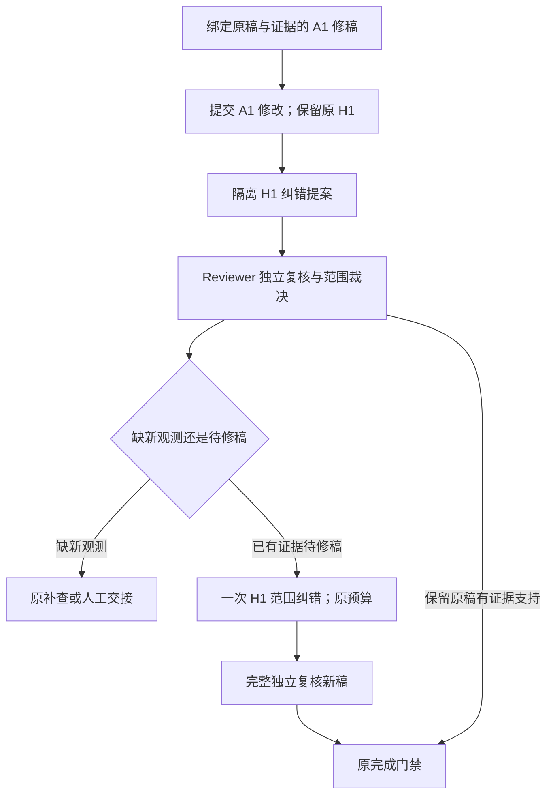

# 非目标假设纠错与修稿范围冲突

本轮在 `codex/review-driven-orchestration` 上继续优化试验编排，标准 `legacy` 仍默认。API 启动参数和旧请求幂等格式不变；新模式报告标记 `review_driven_v2`，分别记录常规纯修稿与范围纠错次数。

## 冲突原因

上一轮错误机制探针预置了 H1：“维护方主动下调账户配额导致失败”，但实际观测只显示连接被拒和依赖错误率。初次复核是明确标注的种子反馈，只要求改写 A1。真实 Diagnosis 改对 A1 的同时也撤回 H1 的无证据归因；原程序按未授权改动拒绝整稿，一次纠正后仍失败，真实 Reviewer 没有机会裁决。这是发现问题与修改授权之间缺少交接通道，不能简单取消范围门禁。

本轮首版把 H1 改动隔离后成功送到真实 Reviewer，但 Reviewer 将因果重写标成 expression，发生 `REVISION_SCOPE_DECISION`。下一版补充动态 Schema 和具体错误路径，获得有效 reasoning 授权；又发现 N2 的“机制稿待改写”被作为证据 blocker，触发 `unresolved_evidence_gap`。缺新观测与尚未完成纠错此前共用 uncertain 状态，分流缺少结构化依据。

## 模块与流程

1. **Diagnosis / RevisionTask**：指定目标仍必须实际修改。非目标 H 的修改作为 `revision_concerns`；程序保留实际稿原 H，并保存未提交候选。显式提案与输出中同目标改动须一致，引用须合法。不恢复或采纳未知引用，不允许增删 F/H/A 或改动非目标行动。
2. **Reviewer / ReviewValidator**：完整复核实际稿和原始观测，同时独立裁决每个提案。`keep` 需要当前观测支持原 H；`revise` 需要未支持 H、当前证据和 reasoning 请求；`evidence` 需要真实证据缺口。提案不是证据，也不继承先前判定。
3. **证据问题分类**：`gap_kind=evidence` 仍沿用 blocker／补查；`gap_kind=revision` 表示已有当前证据、论证待修正，保持 uncertain，关联未支持目标和修稿请求，不能同时填写相关 blocker 或补查。程序不改判 supported，也不关闭核心问题。
4. **Policy / Coordinator**：先处理真实观测与任务缺口；已有证据待改稿时，允许一次经独立裁决的范围纠错。授权只覆盖获裁决的 H reasoning 请求，不把其它目标一起放行。不执行工具、不增加原模型／工具／时间额度，也不重置角色纠正槽。
5. **最终 Reviewer**：范围纠错后的新稿清除旧复核，重新评估全部 F/H/A/N。持续修稿、无效协议、缺证据、过期稿次或预算不足均受控交接，不自动关闭工单。

范围恢复和提案生成是程序的机械处理；提案是否有道理、原 H 是否成立、证据是否充分仍由 Reviewer 判断。协议校验不能证明模型因果判断准确，keep 裁决也可能判断错误。

## 验证边界

`scripts/verify_revision_probe.py --validation-session scope_conflict_followup` 默认生成免费计划。真实运行显式增加 `--execute-live`；三个合成场景各最多 8 次请求，本轮总上限 24 次，跨实现通过 `--previous-summary` 继承计数，保留全部中间失败。

前两版均从预置首轮计划／草稿／反馈开始，后续调用真实模型。第三版错误机制场景原样回放第二版已付费且已成功的初次 A1 修稿回复，只重跑独立范围复核、H1 纠错和最终复核。回放的报告、回复和内容均记录哈希，标记 `new_inference=false`；它不计为新推理，不能作为最终版从头诊断的成绩。其它场景继续使用真实后续模型。

所有种子、回放和真实请求分别计数；工作流 model_calls 包含脚本及回放调用，paid_attempts 只计本轮真实模型请求尝试。无真实修复或业务数据库写入，费用未核实。机器记录见 [revision-scope-validation.json](revision-scope-validation.json)。

## 2026-10-15 实际结果

三版各保留三个场景，共九条运行；真实请求分别为 7、6、8 次，累计 21／24 次，各场景累计为措辞 6 次、触发未知 7 次、错误机制 8 次。最终应用指纹为 `5c3dd35e1afd7c70`，第三版错误机制回放明确绑定第二版原回复。

| 最终场景 | 结果 | 实际证明的行为 | 未证明的部分 |
| --- | --- | --- | --- |
| 措辞修稿 | completed，2 次真实请求 | A1 实际中性改写，F/H 保持一致，当前稿独立复核完成，没有补查或范围扩展 | 仍是种子反馈探针，不能算自主诊断准确率 |
| 触发未知 | partial，MODEL_OUTPUT_INVALID，3 次真实请求 | 编辑范围保持，Reviewer 将触发未知归入 N2；一次纠正后仍只用 H2 trigger 阻塞机制，被门禁拒绝 | 前两版此场景 completed，最终版失败仍保留；不能称为三场景全部通过或以旧成绩替代 |
| 错误机制承接验证 | partial，BUDGET_EXCEEDED，3 次新请求＋1 次已付费回复回放 | 原 H1 未直接采纳；Reviewer 一次纠正后独立授权 reasoning，N2 保持 uncertain／revision；只扩展 H1 一次，新稿 H1 改为“inventory-api连接被拒导致checkout-api请求超时”，0 次补查 | Reviewer 初次同时写 revision 与 blocker，触发 REVISION_NEED_CONFLICT 消耗一次纠正。此场景累计达到 8 次上限，最后稿未独立复核，H1 保持 tentative，建议不发布；不能计为完整纠错成功 |

上一版以范围错误退出；本轮已经实际走到隔离提案、独立授权及限定范围的 H1 改写，但端到端成功仍未验证。待修稿标记不会改判支持，新稿没有继承旧复核。Review 阶段仍存在结构矛盾和机制／触发归属不稳定，试验路径继续显式选择，标准流程不切换。

初版报告将“已有至少两条复核”称为 final_review_completed，这不足以判断第三稿是否已复核。验证器已改为比较最后复核与最后草稿的稿次；旧摘要保留原值，机器记录附加 corrected_controls。错误机制第三版的 corrected_controls.final_review_completed 为 false。

全量免费回归 730 项：710 通过、20 项数据库检查跳过、0 失败；最后增加的稿次指标测试及相关 71 项针对性检查通过。标准路径 15 个历史行为基线一致。初次回归的单一失败是 API 测试仍断言试验报告 v1；随明确版本升级更新为 v2 后回归通过。数据库集成、前端类型和构建本轮未执行；前端没有改动。

以上为上一轮记录。用户随后授权优化 Reviewer 契约并预留末稿复核预算，本轮从种子首稿新调用并完成错误机制末稿独立复核；保留原失败，另见[后续契约与触发归属验证](reviewer-contract-followup.md)。
